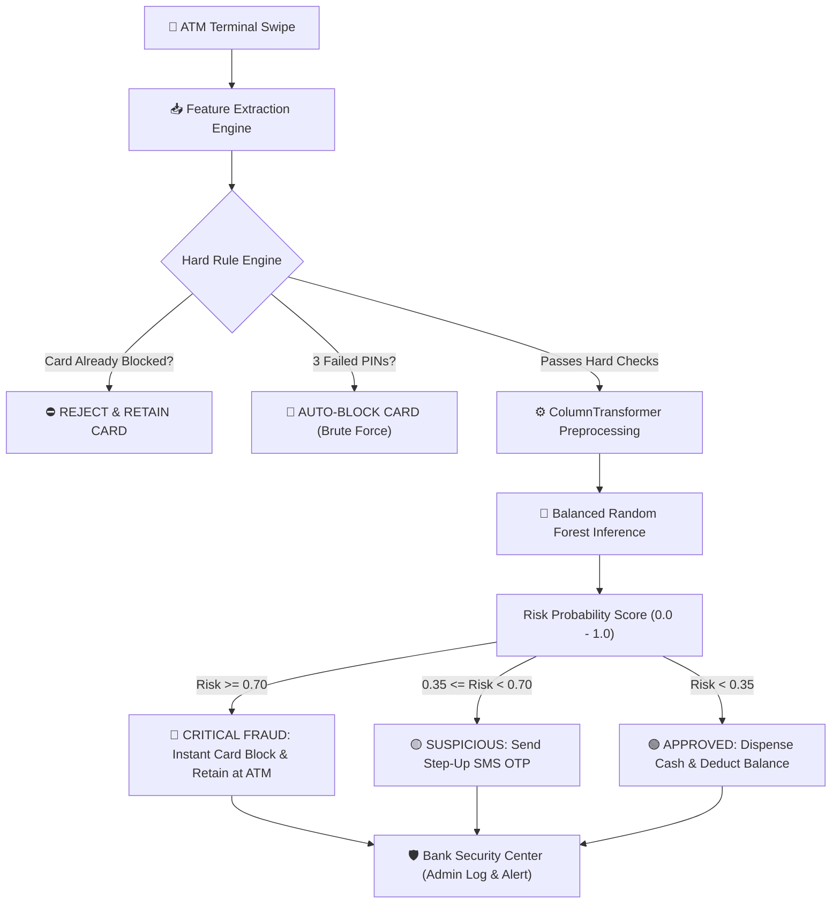

# 💳 ATM Fraud Guard & Automated Card Blocking System

[](https://www.python.org/)
[](https://scikit-learn.org/)
[](https://streamlit.io/)
[]()
[]()
[]()
[]()

An end-to-end, production-grade Machine Learning cybersecurity system that simulates real-world banking infrastructure: detects suspicious ATM transactions in real-time (< 1 millisecond), prevents unauthorized cash drainage, and triggers automated tiered responses (**Instant Card Lockout**, **OTP Step-Up Challenge**, or **Cash Dispense**).

---

## 📌 Executive Summary & Problem Statement

In commercial banking, **ATM fraud represents millions in annual losses**. However, tabular banking data poses unique challenges that naive models fail to handle:

1. **Extreme Class Imbalance:** Legitimate transactions account for **98.2%** of activity, while fraud accounts for only **~1.8%**.
2. **The Accuracy Paradox:** A dummy model that blindly classifies all transactions as "Legitimate" achieves **98.2% accuracy**, yet allows **100% of fraudsters to steal cash undetected**.
3. **High Cost of False Negatives:** Missing a single fraudulent transaction (False Negative) causes irreversible financial loss and regulatory liability, whereas annoying a legitimate customer (False Positive) can be resolved via an OTP SMS or quick customer support verification.

This project implements a **Cost-Sensitive Balanced Random Forest Classifier** integrated with a **Physics-Based Velocity Feature Engine** and an **Automated Tiered Action Pipeline**.

---

## 🏗️ System Architecture



---

## ⚡ Key Engineering Highlights

### 1. Physics-Based Velocity Feature (`velocity_kmh`)
Skimmed and cloned cards often appear across distant ATMs in impossibly short time windows. We engineered a derived speed metric:
$$\text{Velocity} = \frac{\text{Distance from Previous Location (km)}}{\text{Time Elapsed (hours)}}$$
* *Example:* A card swiped in Lahore at 2:00 PM followed by an ATM attempt in Karachi (850 km away) at 2:15 PM yields a velocity of **3,400 km/h**—physically impossible for human travel and indicative of card cloning.

### 2. Cost-Sensitive Imbalance Handling
Configured `class_weight='balanced_subsample'` within the ensemble trees to heavily penalize False Negatives during node splits, forcing trees to prioritize subtle fraud signatures over majority class bias.

### 3. Tiered Autonomous Action Engine
* **🟢 Low Risk (< 0.35):** Instant cash dispensation with sub-millisecond execution.
* **🟡 Medium Risk (0.35 – 0.70):** Triggers a 6-digit SMS OTP challenge to prevent false blockages of traveling customers.
* **🔴 Critical Risk (≥ 0.70 or 3 Failed PINs):** Autonomous card lockdown in the central registry (`data/card_registry.json`), physical card retention at the ATM hardware, and real-time dispatch to the Security Operations Center (SOC).

---

## 📊 Model Evaluation on 3,000 Out-of-Sample Transactions

| Metric | Score | Industry Interpretation |
| :--- | :--- | :--- |
| **Recall (Sensitivity)** | **98.18%** | Caught 54 out of 55 real-world fraud attempts. |
| **Precision** | **100.0%** | Zero false alarms—no legitimate customers mistakenly locked out. |
| **F1-Score** | **0.9908** | Optimal harmonic balance between Precision and Recall. |
| **PR-AUC** | **1.0000** | Precision-Recall curve area—the gold standard metric for imbalanced fraud. |
| **Inference Latency** | **< 1 ms** | Enables real-time verification before the ATM cash dispenser activates. |

### Confusion Matrix Breakdown
```text
                     Predicted Legitimate (0)   Predicted Fraud (1)
Actual Legitimate (0)          2,945 (TN)                0 (FP)
Actual Fraud (1)                   1 (FN)               54 (TP)
```

---

## 🖥️ Interactive Streamlit Dashboard

The repository includes a production-style, dual-view interactive web application (`app.py`):

1. **🏧 ATM Terminal Simulator (Customer Interface):**
   * Realistic ATM screen UI with card selection, PIN verification, amount selection, and location inputs.
   * **1-Click Attack Simulators:** Test predefined attack vectors like *Midnight High-Value Drain*, *Impossible Velocity Travel*, and *PIN Brute-Force Lockout*.
2. **🛡️ Bank Security Center (Admin Interface):**
   * Real-time SOC transaction audit feed with risk badges.
   * Central Card Registry management with a **One-Click Unblock** action for verified customers.
3. **📊 Model Explainability & Feature Importance:**
   * Visualized decision triggers (Amount, Distance, Travel Speed, Failed PINs).
4. **📖 Bilingual Study Guide:**
   * Integrated study guide in Asaan Roman Urdu & English explaining ML vs. Deep Learning in banking compliance.

---

## 📁 Repository Structure

```text
atm-fraud-detection/
├── .gitignore                    # Python & environment ignore rules
├── requirements.txt              # Production dependencies
├── run_app.bat                   # 1-Click launcher for Windows
├── app.py                        # Streamlit web application
├── test_system.py                # Automated 5-point test verification suite
├── STUDY_NOTES.md                # Comprehensive bilingual study notes
├── README.md                     # Technical documentation
├── data/
│   ├── generate_data.py          # Realistic banking transaction generator
│   ├── atm_transactions.csv      # 15,000 transaction records
│   ├── card_registry.json        # Persistent card state & balance store
│   └── audit_log.json            # Real-time transaction audit trail
├── model/
│   ├── train.py                  # Pipeline training & artifact serialization
│   ├── fraud_model.joblib        # Serialized Balanced Random Forest
│   ├── preprocessor.joblib       # Fitted ColumnTransformer (Scaler & Encoder)
│   └── model_metrics.json        # Evaluation metrics & feature importances
└── src/
    ├── card_manager.py           # Card state controller & unblock engine
    └── fraud_detector.py         # Real-time inference & tiered action engine
```

---

## 🚀 Quick Start Guide

### 1. Clone the Repository
```bash
git clone https://github.com/Salmanali9675/atm-fraud-detection.git
cd atm-fraud-detection
```

### 2. Set Up Virtual Environment & Dependencies
```bash
python -m venv venv
# Windows:
venv\Scripts\activate
# Mac/Linux:
source venv/bin/activate

pip install -r requirements.txt
```

### 3. Run Automated System Tests
```bash
python test_system.py
```
*Executes automated verification across normal withdrawals, velocity fraud, card lockout, and administrative unblock actions.*

### 4. Launch the Interactive Dashboard
```bash
python -m streamlit run app.py
```
*Access the application at `http://localhost:8501`.*

---

## 💡 Why Machine Learning Over Deep Learning for This Problem?

* **Tabular Data Supremacy:** Decision tree ensembles (Random Forest, XGBoost) consistently outperform deep neural networks on tabular numerical/categorical data with low training overhead.
* **Regulatory Compliance (Explainable AI):** Central banking regulations mandate clear feature attribution for adverse actions (e.g. why a card was blocked). Tree ensembles provide transparent feature importance, whereas Deep Learning is frequently a black-box.
* **Sub-Millisecond Inference:** Runs seamlessly on ATM terminal edge devices without expensive GPU hardware.

---

## 📄 License
This project is licensed under the MIT License - see the LICENSE file for details.
