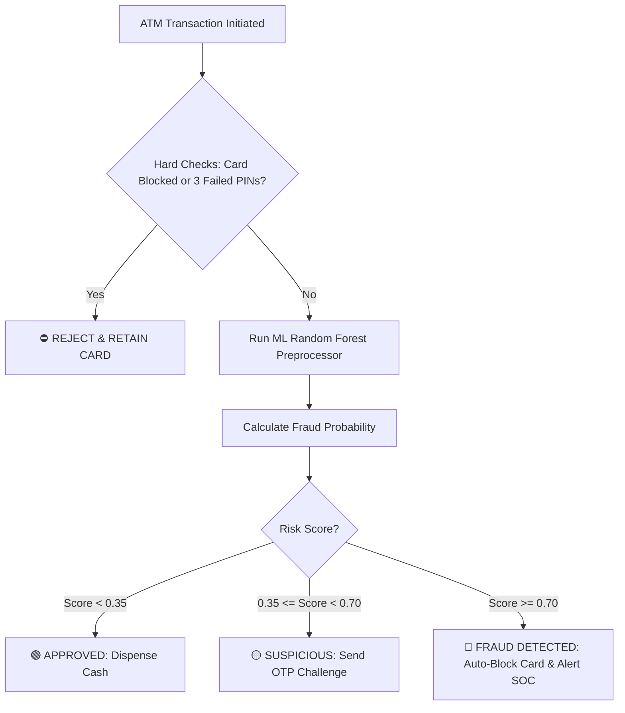

# 💳 ATM Fraud Alert & Automated Card Blocking — Complete Study Notes
*(Asaan Roman Urdu Aur English Mein Complete Revision Guide)*

---

## 📌 Hissa 1: Project Ka Maqsad Aur Real-World Banking

### 1. ATM Fraud Detection Kya Hai?
* **Problem:** Jab koi chor (fraudster) kisi masoom shakhs ka ATM card chura le, card skim kar le (duplicate copy bana le), ya PIN guess karne ki koshish kare, to woh seconds ke andar account khali kar sakta hai.
* **Solution:** Hamara Machine Learning system har aane wali ATM transaction ko real-time analyze karta hai aur 1 millisecond ke andar faisla karta hai ke:
  1. 🟢 **Transaction Approved:** Normal transaction, paise nikal aate hain.
  2. 🟡 **OTP Verification (Suspicious):** Kuch shakki laga to registered phone par OTP SMS bhejo.
  3. 🔴 **INSTANT CARD BLOCK (Critical Fraud):** Agar fraud ka yaqeen ho jaye to **card foran block** kar do aur ATM machine card ko andar zabt (retain) kar le taake chor bhaag na sake!

---

## 📌 Hissa 2: Deep Learning Kyun Compulsory Nahi Hai?

> [!NOTE]
> **Sub se ahem sawaal:** *"Kya Fraud Detection ke liye Deep Learning zaroori hai?"*
> **Jawab:** **Bilkul Nahi!** Real-world banks (jaise HBL, Meezan, Chase, Barclays) tabular data par classical Machine Learning (Random Forest, XGBoost, LightGBM) hi use karte hain.

### 4 Bari Wajahat (Why ML is King for Tabular Banking Data):
1. **Tabular vs Unstructured Data:**
   * **Deep Learning (Neural Networks):** Images, Video, Audio, aur Natural Language (Text) ke liye banaya gaya hai.
   * **Machine Learning (Tree Models):** Rows aur Columns (Numbers, Amounts, Timestamps) ke tabular data par **Random Forest** aur **Gradient Boosted Trees** hamesha deep learning se tez aur behtar perform karte hain.
2. **Explainability & Regulations (Qanooni Pabandi):**
   * Central Bank (State Bank ya Federal Reserve) ka qanoon hai ke bank kisi customer ka card andha ho kar block nahi kar sakta. Bank ko saboot dena parta hai ke: *"Amount 8 guna zyada thi, 3 baje raat ko thi, aur location 800km door thi."*
   * Tree models mein **Feature Importance** aur **Decision Rules** 100% wazeh (transparent) hotay hain. Deep Learning aksar ek "Black Box" hota hai jahan waja samajh nahi aati.
3. **Ultra-Low Latency (Raftaar):**
   * Jab customer ATM mein card daal kar PIN enter karta hai, to system ke paas sirf **kuch milliseconds** hotay hain.
   * Random Forest sub-millisecond mein result de deta hai bina kisi heavy GPU ke.
4. **Learning Foundation:**
   * High-stakes imbalanced classification (False Positives vs False Negatives) ko pehle Machine Learning mein samajhna Deep Learning shuru karne ke liye sab se behtareen bunyaad hai!

---

## 📌 Hissa 3: Extreme Class Imbalance & The Accuracy Paradox

### 1. Extreme Class Imbalance Kya Hai?
* Customer Churn mein ~25% log churn kar rahe thay.
* Lekin Banking Transactions mein **98.2% transactions shareef logon ki hoti hain**, aur sirf **~1.8% transactions fraud** hoti hain!
* Isay kehte hain **Severe Class Imbalance**.

### 2. The Accuracy Paradox (Dhokaybaaz Accuracy)
* Farz karein hamare paas 10,000 transactions hain jin mein se:
  * 9,820 Legitimate (Normal) hain.
  * 180 Fraud hain.
* Agar koi aalsi (lazy) model har transaction ko keh de: *"Koi fraud nahi hai (0)"*, to uski **Accuracy kitni aayegi?**
  $$\text{Accuracy} = \frac{9820}{10000} = 98.2\%!$$
* **Lekin is 98.2% accuracy ka faida kya?**
  * Woh un 180 choron mein se **ek chor ko bhi nahi pakar saka!** Bank ke karoron rupay lut gaye!
* **Golden Rule:** Fraud detection jaise imbalanced projects mein **Accuracy bilkul andhi metric hai**. Yahan hum **Recall**, **Precision**, aur **PR-AUC** dekhte hain!

---

## 📌 Hissa 4: Precision vs Recall (Banking Ka Zindagi Aur Maut Ka Faisla)

| Metric | Simple Meaning | Banking Example |
| :--- | :--- | :--- |
| **Recall (Sensitivity)** | Tamam asli choron mein se model ne kitne chor pakre? | Agar 100 chori ki koshishein huin, aur model ne 98 pakar li to Recall = 98%. |
| **Precision** | Model ne jinhein chor kaha, un mein se waqai kitne chor thay? | Agar model ne 100 cards block kiye aur 95 waqai chor thay (5 shareef log thay), to Precision = 95%. |

### False Positive vs False Negative:
* **🔴 False Negative (FN) — *Bank Ki Maut!*:**
  * Model ne samjha ke transaction normal hai, lekin asal mein chor paise nikal raha tha!
  * **Nateeja:** Customer ke paise chori, bank par case, bad reputation.
  * **Hadaf:** Banks chahte hain ke **False Negative = ZERO** ke qareeb ho (Maximum Recall!).
* **🟡 False Positive (FP) — *Takleef De Lekin Mehfooz*:**
  * Asli customer shopping kar raha tha, model ne shakki samajh kar OTP bhej diya ya card block kar diya.
  * **Nateeja:** Customer naraz hua, lekin paise mehfooz rahe. Customer helpline pe call karke card unblock karwa sakta hai.

---

## 📌 Hissa 5: Ahem Features (Fraud Pakarne Ke Asli Nishanaat)

Hamare model ne training mein sab se zyada in cheezon se fraud pakra:

1. **Transaction Amount (Qeemat):**
   * Normal log aam tor par 1,000 se 10,000 nikalte hain. Fraudsters foran ATM ki maximum limit (Rs. 25,000 se 50,000) drain karne ki koshish karte hain.
2. **Velocity & Impossible Travel (Ghair-Fitri Raftaar):**
   * Formula: `velocity_kmh = location_distance / (time_diff_hours)`
   * Agar card 15 minute pehle Karachi ke ATM par swipe hua tha, aur ab 850 km door Lahore ke ATM par swipe ho raha hai, to raftaar nikli:
     $$\frac{850 \text{ km}}{0.25 \text{ hours}} = 3,400 \text{ km/h!}$$
   * Koi insaan 15 minute mein Karachi se Lahore nahi pohonch sakta! Yeh 100% Card Skimming (clone copy) ka fraud hai!
3. **Failed PIN Attempts (PIN Ke Ghalat Dakhilay):**
   * Chor agar 3 baar ghalat PIN lagaye to machine foran card block kar deti hai (Brute Force Protection).
4. **Midnight Surge (Raat Ke 2 se 4 Baje):**
   * Raat ke aakhri hissay mein sunsan ATMs par achanak bari raqam nikalna bohot bara risk signal hota hai.
5. **Daily ATM Frequency (Baar Baar Withdrawal):**
   * Ek hi din mein 4th ya 5th baar paise nikalna.

---

## 📌 Hissa 6: Tiered Automated Action Architecture

Hamara system 3 darjaat (tiers) par faisla karta hai:

---

## 📌 Hissa 7: Interview & Viva Questions

### Q1: Fraud detection mein Accuracy kyun nahi use karte?
> **Jawab:** Kyunke fraud data mein extreme class imbalance hota hai (e.g. 99% normal, 1% fraud). Ek aalsi model jo har kisi ko "Normal" kahega uski accuracy 99% aayegi lekin woh ek bhi fraud nahi pakar sakega. Is liye hum **Recall, Precision, F1-Score, aur PR-AUC** use karte hain.

### Q2: False Negative aur False Positive mein se ziada nuqsaandeh kaunsa hai?
> **Jawab:** Banking fraud mein **False Negative** bohot ziada nuqsaandeh hai. False Negative ka matlab hai chor chori karke bhaag gaya aur system ne usay nahi roka. False Positive mein customer thori dair ke liye pareshan hota hai lekin paise bach jatay hain.

### Q3: Tabular fraud detection ke liye Deep Learning kyun choose nahi kiya?
> **Jawab:**
> 1. Tabular data par Tree-based models (Random Forest, XGBoost) Deep Learning se behtar ya barabar perform karte hain.
> 2. Banks ko Central Bank ke compliance qawaneen ke teht Explainability (Feature Importance/SHAP) deni hoti hai.
> 3. Tree models sub-millisecond mein ATM par execute ho jatay hain bina heavy GPU hardware ke.
